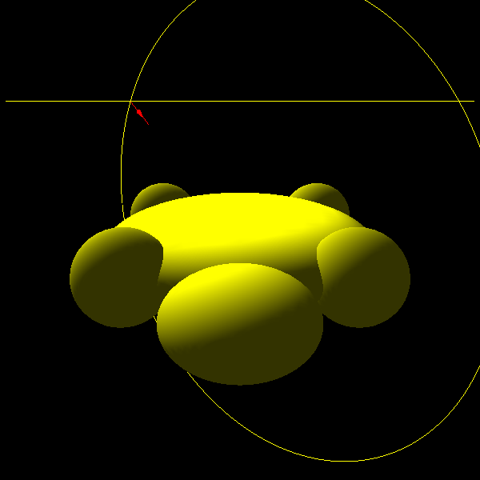

# opengl-lighting

[](https://github.com/Wil12Fred/university-coursework/actions/workflows/opengl-lighting.yml) [](../LICENSE)

OpenGL lighting exercise from a computer graphics course: a turtle made of
spheres lit by the three kinds of fixed-function OpenGL light — directional,
positional and spot — each of which you can switch on, move around the scene
on a sphere, and (the spot) aim with the mouse.



*The directional light switched on (F8, F9), with its parallel, meridian and
direction vector drawn. All lights start off, so at launch the turtle is lit
only by the dim ambient light.*

## Features

- Three `Light` objects (directional, positional, spot) driving
  `GL_LIGHT0`–`GL_LIGHT2`, with attenuation for the positional and spot lights.
- Lights move on a sphere around the origin (longitude/latitude with the
  mouse) and closer/farther by dragging; the spot can be aimed separately.
- Camera with examine (orbit) and walk modes, back-face culling toggle, and a
  small turtle-graphics command mode (`fd 1`, `rt 30`, `home`, …).

| Key | Action |
|---|---|
| F8 | select the next light (0 directional, 1 positional, 2 spot) |
| F9 | switch the selected light on or off |
| F10 | (spot selected) toggle between moving the spot and aiming it |
| mouse move / drag | move the selected light / drag moves it closer or farther |
| F1 | stop: leave light mode, freeze the camera |
| F2 | examine mode: the mouse orbits the camera, drag zooms |
| F3 | walk mode: drag to walk and turn |
| F6 | reset the camera |
| c | toggle back-face culling |
| i | command mode: type `fd 1`, `rt 30`, `home`, `exit`... then Enter |
| h | print help to the terminal |
| q / Esc | quit |

## Requirements

- Debian/Ubuntu: `sudo apt install g++ make freeglut3-dev` (plus `xvfb` to run
  the smoke test without a display)
- Arch: `sudo pacman -S gcc make freeglut` (plus `xorg-server-xvfb`)

On macOS the system GLUT framework is used.

## Build

```sh
make
```

## Run

```sh
./iluminacion
```

It opens a window and prints nothing until you press a key (`h` prints the
help, F8 prints `Luz actual = 0`, …).

## Tests

```sh
make test
```

- `tests/unit_tests.cc` tests the maths that needs no window, built with
  AddressSanitizer, UBSan and `-ftrivial-auto-var-init=pattern` (so an
  uninitialised variable shows up as a failure, not as luck):
  - `VectorNormalize` (unit result; a zero vector sets `ierr` and gives
    (0,0,1)), the cross products x×y = z, y×z = x, z×x = y, and `UnitVectorPP`;
  - `VectorRotY`: a quarter turn takes +Z to +X, four of them return to the
    start, and the length never changes;
  - `VectorRotXZ`: going up in latitude stops just short of the pole and never
    crosses it;
  - `Light`: moving in longitude keeps the light on its sphere, moving
    closer/farther changes the distance by exactly the step along the same
    direction, and never below 0.8.
- The smoke run starts `./iluminacion` (under `xvfb-run` when there is no
  display) and passes if the window is still open after 5 s.

## Project layout

| File | Contents |
|---|---|
| `main.cpp` | GLUT window, input handlers, scene setup |
| `Light.h` | `Light` class: directional / positional / spot, movement on a sphere |
| `Camara.h` | camera with examine and walk modes |
| `primitivas.h` | turtle model and the light helpers (parallel, meridian, spot cone) |
| `Vector_tools.h` | small vector math helpers |
| `tests/unit_tests.cc` | unit tests of the above maths |

## Known limitations

- Moving a light closer/farther used an uninitialised error flag, so depending
  on the stack the step was not normalised and the light jumped by a multiple
  of its distance; the vector-drawing helper had the same flag. Fixed, with a
  test.
- Uses the fixed-function pipeline and GLUT, both deprecated (no shaders).
- The `Light` copy constructor copies nothing (it is never used).

## Background

Written for a computer graphics course at university, 2018.

## License

MIT — see [LICENSE](../LICENSE).
